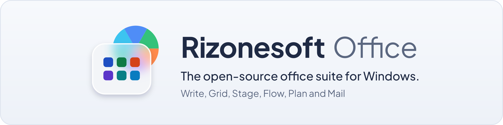
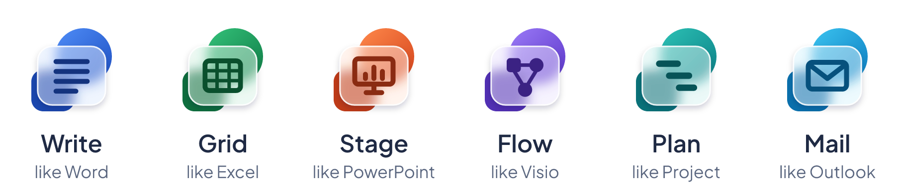

<picture>
  <source media="(prefers-color-scheme: dark)" srcset="docs/assets/github/banner-dark.png">
  <source media="(prefers-color-scheme: light)" srcset="docs/assets/github/banner-light.png">
  
</picture>

# Rizonesoft Office

Rizonesoft Office is an open-source office suite for Windows, being built to match Microsoft 365 feature by feature and control by control, with its own name, icons and artwork. It is planned as a Windows desktop suite in WinUI 3 with C# on .NET, to ship as an MSIX package and a classic installer.

<picture>
  <source media="(prefers-color-scheme: dark)" srcset="docs/assets/github/lineup-dark.png">
  <source media="(prefers-color-scheme: light)" srcset="docs/assets/github/lineup-light.png">
  
</picture>

| App | For the work of | Status |
| --- | --------------- | ------ |
| Rizonesoft Write | Microsoft Word | Planned |
| Rizonesoft Grid | Microsoft Excel | Planned |
| Rizonesoft Stage | Microsoft PowerPoint | Planned |
| Rizonesoft Flow | Microsoft Visio | Planned |
| Rizonesoft Plan | Microsoft Project | Planned |
| Rizonesoft Mail | Microsoft Outlook | Planned |

Rizonesoft Office is not affiliated with or endorsed by Microsoft. Microsoft, Word, Excel, PowerPoint, Visio, Project and Outlook are trademarks of Microsoft Corporation, named here only to describe compatibility.

## Status

Planning and design. The plan lives in [`todo/`](todo/TODO-00-INDEX.md); icons and brand assets are in [`assets/`](assets/icons/README.md). The repository keeps the name `Office` (`rizonesoft/Office`), the owner's decision of 2026-10-22.

## Licence

Rizonesoft Office is free software: you can redistribute it and modify it under the terms of the GNU General Public License as published by the Free Software Foundation, either version 3 of the License, or (at your option) any later version (`GPL-3.0-or-later`). The full text is in [`LICENSE`](LICENSE). Contributions require the Rizonesoft contributor agreement, which is being prepared.

Bundled third-party material keeps its own licence: the Plus Jakarta Sans font is under the SIL Open Font License 1.1 ([`design/fonts/plus-jakarta-sans/OFL.txt`](design/fonts/plus-jakarta-sans/OFL.txt)).
